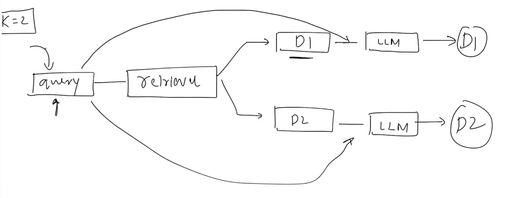

# What are Retrievers:

It is a component in LangChain that fetches relevant documents from a data source in response to a user's query

All type of retrievers in LangChain are runnable (means you can execute any retriever using consistent methods like .invoke(), .batch(), or .stream(), and seamlessly plug it directly into chains using the pipe (|) operator alongside prompts and LLMs without needing extra wrapper code)

# There are multiple types of retrievers based on data source:

## (1) Wikipedia Retriever:

It connects directly to the Wikipedia API to fetch relevant articles based on a user query and returns them as Document objects

### Working:

- you give it query

- it sends the query to Wikipedia API

- it retrieve the most relevant articles (internally keywords based retrieving most relevant articles)

- it returns them as Document objects

## (2) Vector Store Retriever:

It is most common type of retriever that lets you search and fetch documents from a vector store based on semantic similarity using vector embeddings

### Working:

- store your documents in vector store(like FAISS, Chroma, Weaviate)

- each document is converted into a dense vector using embedding model

- when the user enters a query then it also turned into a vector and the retriever compares the query vector with the stored vectors then it retrieves the top-k most similar ones

## (3) Arxiv Retriever:

It is a built-in LangChain retriever that connects directly to the arXiv API to search and fetch academic and research papers based on a query or paper ID, returning their abstracts and metadata as Document objects

# There are multiple types of retrievers based on search strategy:

## (1) Maximal Marginal Relevance (MMR) Retriever:

"How can we pick results that are not only relevant to the query but also different from each other?"

Thats why we use MMR Retriever because ->

It is information retrieval algorithm designed to reduce redundancy in the retrieved results while maintaining high relevance to the query

## Why MMR Retriever?

In regular similarity search, you may get documents that are:

- All very similar to each other

- Repeating the same info

- Lacking diverse perspectives

### Conclusion:

- MMR Retriever avoids that by picking the most relevant document first then picking the next most relevant and least similar to already selected docs and so on

- It is useful when documents are semantically overlapping

## (2) Multi-Query Retriever:

Sometimes a single query might not capture all the ways information is phrased in your documents

For example->

user_query = How can I stay healthy?

It could multiple mean:

- What should I eat?

- How often should I exercise?

- How can I manage stress?

A simple similarity search might miss documents that talk about those things but dont use the word "healthy"

### Working:

- Take your original query

- Uses an LLM to generate multiple semantically different versions of that query

- Performs retrieval for each sub-query

- Combines and deduplicates the results (it means combines each document objects that are retrieve from each sub-query and if there is any duplicate retrieved document then it will remove them)

## (3) Contextual Compression Retriever:

It is an advanced retriever that improves retrieval quality by compressing documents after retrieval, keeping only the relevant content based on the user's query.

For example ->

Query = What is photosynthesis?

Retrieved Document (by a traditional retriever):

"The Grand Conyon is a famous natural site.

Photosynthesis is how plants converts light into energy.

Many tourists visit every year."

### Problem:

- The retriever returns the entire paragraph

- Only one sentence is actually relevant to the query

- Rest is irrelevant noise that wastes context window may confuse the LLM

### Conclusion:

Contextual Compression Retriever returns only the relevant part e.g ->

"Photosynthesis is how plants converts light into energy."

### Workflow:

- Base Retriever (eg-> FAISS, Chroma) retrieves N documents

- A compressor (usually an LLM) is applied to each document

- The compressor keeps only the relevant parts to the query

- Irrelevant content is discarded

### When to Use:

- Your documents are long and contains mixed information

- You want to reduce context length for LLMs

- You need to improve answer accuracy in RAG pipelines

# More Retrievers:

- ParentDocumentRetriever

- TimeWeightedVectorRetriever

- SelfQueryRetriever

- EnsembleRetriever

- MultiVectorRetriever

- BM25Retriever